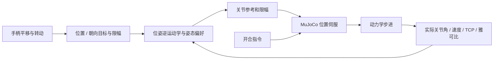

# 手柄控制机械臂 · MuJoCo 算法实验

使用普通手柄控制夹爪末端的 **平移、转动和开合**；控制器计算关节参考，MuJoCo 模拟关节执行器与动力学。可在 MuJoCo 窗口内直接操作，也可使用网页控制。此项目为实验原型，不连接真实机械臂。

## 快速开始

### B601-RS：Windows / Linux

需要 Python 3.10 或更新版本和图形桌面环境；首次运行需要联网下载依赖和 B601-RS 模型资源。Linux 原生键盘输入目前使用 X11，Wayland 会话尚未验证。项目自带 UR5e 和 Panda 模型，B601-RS 模型由启动流程从固定版本的 Seeed 官方仓库获取并在本机生成，不随仓库发布。

1. 从 [GitHub 项目页面](https://github.com/ZSMDTR/Gamepad-Controlled-Robotic-Arm-Simulation)选择 **Code → Download ZIP**，解压到英文路径，例如 Windows 的 `C:\arm-teleop` 或 Linux 的 `~/arm-teleop`；也可以使用 Git 克隆。
2. Windows：双击项目目录中的 `start-mujoco-b601.cmd`。Linux：在项目目录的终端运行 `bash start-mujoco-b601.sh`。首次启动会创建独立 Python 环境、安装依赖并获取模型；后续使用相同命令启动。
3. 名称包含 **B601-RS Refined Rotation** 的 MuJoCo 窗口会显示桌面与方块。点击窗口使其获得焦点，在窗口内直接控制：键盘按住 Shift，配合 W/S、A/D、Q/E 分别前后、左右、上下平移；I/K、J/L、U/O 分别绕世界 X、Y、Z 轴转动；Z/X 开合。手柄按住 LB 使能，左摇杆前后和左右对应前后和左右，右摇杆上下对应上下；同时按 RB 切换转动，A/B 控制夹爪。无需打开网页。标准左右侧栏可查看仿真，但执行器滑块会被控制器覆盖。

原生窗口中红色 +X 指向桌面（前），绿色 +Y 指向机械臂自身的左，蓝色 +Z 向上。场景固定箭头和跟随末端的箭头都表示世界方向，末端箭头不随夹爪旋转；转动正方向按右手定则。手柄每次只取幅度最大的一个摇杆轴以减少串轴，切换平移与转动时，偏离的轴需要先回中。原生控制采用较慢的约束 DLS，指令速度可在 `optimized_algorithm/native_control.py` 中修改；实际运动受模型、接触和关节约束影响，不能保证完全无偏差。完整对应表见 [B601-RS 使用说明](B601-RS_使用说明.md)。

Linux 需要可用的桌面图形会话。Ubuntu 若提示缺少 `venv`，可先安装系统包 `sudo apt install python3-venv`（具体包名可能取决于 Python 版本）。首次安装失败时请查看启动终端中的错误，确认网络与 Python 后重试。详情、操作方法和仿真限制见 [B601-RS 使用说明](B601-RS_使用说明.md)。

### 手动运行网页仿真

需要 Python 3.10+、MuJoCo 支持的系统，以及支持 Gamepad API 的桌面浏览器。以下方式可运行自带的 UR5e 和 Panda 模型：

```bash
git clone https://github.com/ZSMDTR/Gamepad-Controlled-Robotic-Arm-Simulation.git
cd Gamepad-Controlled-Robotic-Arm-Simulation
python -m venv .venv
# Linux / macOS:
source .venv/bin/activate
# Windows PowerShell: .venv\Scripts\Activate.ps1
python -m pip install -e .
python -m arm_teleop
```

打开 [本地仿真页面](http://127.0.0.1:8000)，连接手柄并按任意键使浏览器识别。端口占用时可运行 `python -m arm_teleop --port 8001`。请在桌面浏览器点击页面，使其获得焦点。

## 网页操作方法

下表适用于手动运行网页仿真；B601-RS 原生窗口的键盘使能键是 Shift，操作见 [B601-RS 使用说明](B601-RS_使用说明.md)。

| 控制 | 功能 |
| --- | --- |
| 按住 LB | 使能运动和夹爪；松开后减速并保持 |
| 左摇杆 | 默认模式下控制末端 X / Y 平移 |
| 右摇杆上下 | 默认模式下控制 Z 上升 / 下降 |
| 按住 RB | 切换到转动模式：右摇杆上下俯仰、左右偏航；左摇杆上下滚转，左右也可调节俯仰 |
| A / B | 夹爪打开 / 闭合；两键同时按下互相抵消 |
| 方向模式切换 | 切换时处于偏离状态的摇杆轴先回中，再启用该轴；其他已回中的轴可以继续使用 |
| 键盘备用 | 按住空格使能；WASD 和 Q/E 平移；I/K、J/L、U/O 转动；Z/X 开合 |

手柄首次接入、页面失焦或断开后，请先松开 LB、让摇杆回中，再按 LB 继续。此版本只自动识别浏览器 `standard` 映射；不受支持的手柄可使用键盘备用。设备、浏览器和系统的具体组合需要实测。

页面可选 **UR5e**、**Panda**，以及本机模型准备完成后的 **B601-RS**；并可选择四种算法：

- **DLS**：默认，统一求解位置与朝向。
- **位置优先**：先求位置，再在数值零空间中尽量求朝向；后续关节裁剪可能改变严格优先关系。
- **姿态扩展 SDLS（实验）**：将原位置 SDLS 的分方向限幅启发式扩展到尺度化位姿任务；这不是论文原版姿态算法，也不保证比 DLS 更好。

另提供 **约束 DLS（实验）**：在求解关节速度时考虑参考速度、加速度与关节位置等限制，以减少求解后逐关节裁剪造成的偏差。原有方法保留为对照，实际表现需按模型与任务测试；算法核心和说明见 [`optimized_algorithm/`](optimized_algorithm/README.md)。

画面中的红、绿、蓝线标示夹爪局部坐标轴；左下角“实际朝向”显示世界坐标下的滚转、俯仰、偏航角。右侧“转动指令”显示当前手柄发送的方向；它为零时，检查 LB 和 RB 是否同时按住，以及对应摇杆轴是否已回中。欧拉角仅用于显示，接近特殊角度或跨越 ±180° 时数值可能跳变；控制仍使用旋转矩阵。

## 控制链路



固定仿真控制周期为 10 ms，物理步长 2 ms（每次控制更新 5 个物理步）。Python 循环是软实时调度，不能保证 100 Hz；网页测得的计算时间不等于手柄到夹爪的总延迟。250 ms 无输入后控制器进入减速保持；重新使能需先松开 LB。

TCP 的位置与朝向，以及关节状态从 MuJoCo 读取。页面绘制的是根据仿真关节点和 TCP 生成的**简化示意图**，不是 MuJoCo 网格渲染。UR5e 上的平行夹爪为演示模型；Panda 使用其模型中的夹爪。两个模型的来源、修订号及许可证分别保存在 `robot_models/ur5e/` 和 `robot_models/panda/`。

## 测试

```bash
python -m unittest discover -s tests -v
# 可选：使用 Node.js 验证标准手柄映射及模式切换
node tests/test_gamepad.cjs
```

测试涵盖六维位姿控制、雅可比有限差分、两种 MuJoCo 机械臂的平移/转动/夹爪物理步进、输入超时和旧位置算法。标准手柄映射测试使用模拟输入；实体手柄需在目标浏览器中另行验证。

## 已知边界

- B601-RS 提供桌面与方块用于尝试夹取、移动；接触与摩擦是仿真近似，夹取效果尚需针对实际操作验证，不能推断实物表现。其他模型的场景不一定包含抓取物体，也没有完整环境避碰。
- 模型参数与位置伺服会产生静止跟踪偏差；仿真没有经过实机系统辨识，也未验证真实机械臂。
- 参考速度和加速度限幅不能直接保证真实或仿真关节的实际运动完全满足限值；关节约束冲突可能需要更严格的优化器。
- 肘部滑块调节初始关节姿态偏好，不是显式的肘部空间轨迹规划。六轴完整位姿控制通常没有额外连续自由度任意调整肘部。
- 姿态扩展 SDLS 的位置/角度尺度和目标权重是实验参数，需要同一场景下对比。
- 仿真夹爪无末端力传感器；开合位置不表明物体是否被夹牢，不能推断实机夹持力。

算法细节见 [位姿控制说明](docs/pose-control.md)，第一版位置控制说明保留在 [原算法记录](docs/algorithm.md)。

## 模型来源

模型由 Google DeepMind 的 [MuJoCo Menagerie](https://github.com/google-deepmind/mujoco_menagerie) 简化而来；UR5e 模型为 BSD-3-Clause，Panda 模型为 Apache-2.0，详见各模型目录的许可证和 `SOURCE.txt`。
