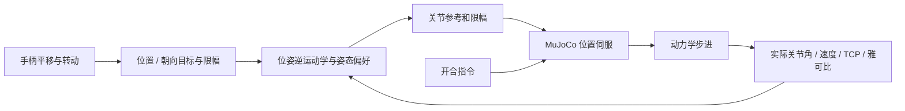

# 手柄控制机械臂 · MuJoCo 算法实验

使用普通手柄控制夹爪末端的 **平移、转动和开合**；控制器计算关节参考，MuJoCo 模拟关节执行器与动力学。网页显示来自仿真的实际状态。此项目为实验原型，不连接真实机械臂。

## 快速开始

需要 Python 3.10+、MuJoCo 支持的系统，以及支持 Gamepad API 的桌面浏览器。模型随仓库提供。

```bash
git clone https://github.com/ZSMDTR/Gamepad-Controlled-Robotic-Arm-Simulation.git
cd Gamepad-Controlled-Robotic-Arm-Simulation
python -m venv .venv
# Linux / macOS:
source .venv/bin/activate
# Windows PowerShell: .venv\Scripts\Activate.ps1
python -m pip install -e .
python -m arm_teleop
```

打开 [本地仿真页面](http://127.0.0.1:8000)，连接手柄并按任意键使浏览器识别。端口占用时可运行 `python -m arm_teleop --port 8001`。请在桌面浏览器点击页面，使其获得焦点。

## 操作方法

| 控制 | 功能 |
| --- | --- |
| 按住 LB | 使能运动和夹爪；松开后减速并保持 |
| 左摇杆 | 默认模式下控制末端 X / Y 平移 |
| 右摇杆上下 | 默认模式下控制 Z 上升 / 下降 |
| 按住 RB | 切换到转动模式：左摇杆和右摇杆左右控制三个转动方向 |
| A / B | 夹爪打开 / 闭合；两键同时按下互相抵消 |
| 方向模式切换 | 松开摇杆回到中间后才启用新方向，避免轴含义突变 |
| 键盘备用 | 按住空格使能；WASD 和 Q/E 平移；I/K、J/L、U/O 转动；Z/X 开合 |

手柄首次接入、页面失焦或断开后，请先松开 LB、让摇杆回中，再按 LB 继续。此版本只自动识别浏览器 `standard` 映射；不受支持的手柄可使用键盘备用。设备、浏览器和系统的具体组合需要实测。

页面可选 **UR5e** 或 **Panda**，以及三种算法：

- **DLS**：默认，统一求解位置与朝向。
- **位置优先**：先求位置，再在数值零空间中尽量求朝向；后续关节裁剪可能改变严格优先关系。
- **姿态扩展 SDLS（实验）**：将原位置 SDLS 的分方向限幅启发式扩展到尺度化位姿任务；这不是论文原版姿态算法，也不保证比 DLS 更好。

## 控制链路



固定仿真控制周期为 10 ms，物理步长 2 ms（每次控制更新 5 个物理步）。Python 循环是软实时调度，不能保证 100 Hz；网页测得的计算时间不等于手柄到夹爪的总延迟。250 ms 无输入后控制器进入减速保持；重新使能需先松开 LB。

TCP 的位置与朝向，以及关节状态从 MuJoCo 读取。页面绘制的是根据仿真关节点和 TCP 生成的**简化示意图**，不是 MuJoCo 网格渲染。UR5e 上的平行夹爪为演示模型；Panda 使用其模型中的夹爪。两个模型的来源、修订号及许可证分别保存在 `robot_models/ur5e/` 和 `robot_models/panda/`。

## 测试

```bash
python -m unittest discover -s tests -v
# 可选：使用 Node.js 验证标准手柄映射及模式切换
node tests/test_gamepad.cjs
```

测试涵盖六维位姿控制、雅可比有限差分、两种 MuJoCo 机械臂的平移/转动/夹爪物理步进、输入超时和旧位置算法。标准手柄映射测试使用模拟输入；实体手柄需在目标浏览器中另行验证。

## 已知边界

- 当前只有机械臂和夹爪，没有桌面或抓取物体，无法评价抓取成功率和环境避碰。
- 模型参数与位置伺服会产生静止跟踪偏差；仿真没有经过实机系统辨识，也未验证真实机械臂。
- 参考速度和加速度限幅不能直接保证真实或仿真关节的实际运动完全满足限值；关节约束冲突可能需要更严格的优化器。
- 肘部滑块调节初始关节姿态偏好，不是显式的肘部空间轨迹规划。六轴完整位姿控制通常没有额外连续自由度任意调整肘部。
- 姿态扩展 SDLS 的位置/角度尺度和目标权重是实验参数，需要同一场景下对比。
- 仿真夹爪无末端力传感器；开合位置不表明物体是否被夹牢，不能推断实机夹持力。

算法细节见 [位姿控制说明](docs/pose-control.md)，第一版位置控制说明保留在 [原算法记录](docs/algorithm.md)。

## 模型来源

模型由 Google DeepMind 的 [MuJoCo Menagerie](https://github.com/google-deepmind/mujoco_menagerie) 简化而来；UR5e 模型为 BSD-3-Clause，Panda 模型为 Apache-2.0，详见各模型目录的许可证和 `SOURCE.txt`。
